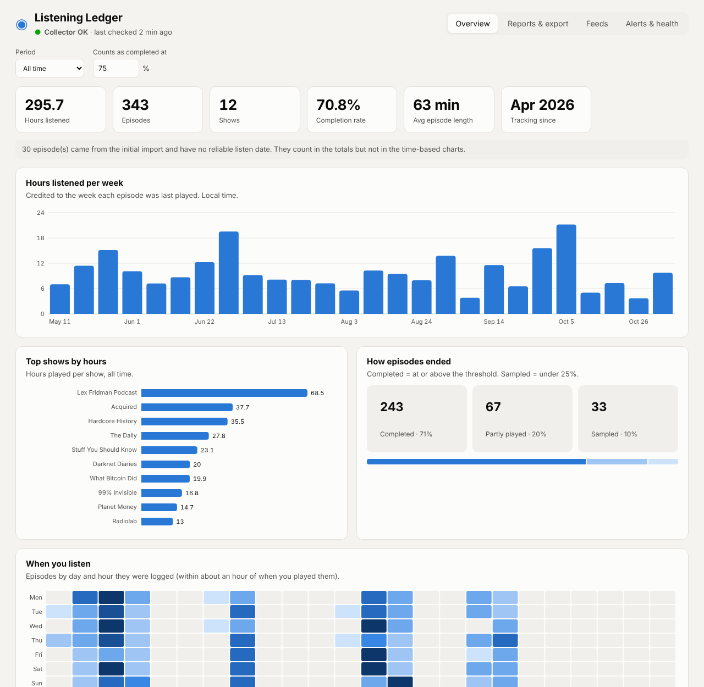

# Pocket Casts Listening Ledger

Pocket Casts only keeps your listening history for a limited time, and old entries eventually drop off. **Listening Ledger** saves a permanent copy on your own computer. It checks your history every hour and adds anything new to a local SQLite database. A local web dashboard shows your listening stats and builds OPML, Excel and CSV exports.



> **Unofficial.** This project is not affiliated with or endorsed by Pocket Casts or Automattic. It uses the same private API as the Pocket Casts web player, and that API can change at any time. It only *reads* your data and never changes anything in your account.

## Contents

- [Features](#features)
- [Requirements](#requirements)
- [Install](#install)
- [Schedule it](#schedule-it)
- [Dashboard](#dashboard)
- [Reports](#reports)
- [Feeds and OPML](#feeds-and-opml)
- [Alerts](#alerts)
- [Podcast Index (optional)](#podcast-index-optional)
- [Command line](#command-line)
- [Configuration](#configuration)
- [Data model](#data-model)
- [Privacy: what leaves your computer](#privacy-what-leaves-your-computer)
- [Troubleshooting](#troubleshooting)
- [Uninstall](#uninstall)

## Features

- **Permanent history.** Every episode that shows up in your Listening History gets logged, and nothing is ever deleted.
- **Re-listens count.** Replaying an older episode moves it back to the top of your history, and the ledger logs that as another listen.
- **Progress tracking.** It records where you'd gotten to in an episode when the listen was logged, and where you are now, so you can tell finished episodes from ones you sampled.
- **Credentials stay private.** Your password is stored in your operating system's credential store (Windows Credential Manager, macOS Keychain, or Secret Service on Linux), never in a plain file. The login token is cached there too, so the collector only logs in again when the token expires.
- **Dashboard.** Hours per week, top shows, how often you finish episodes, when you listen (a day-by-hour heatmap), new shows per month, unfinished episodes, and recent listens, for any period.
- **Three show reports.** Top shows by completed episodes, top shows by hours, and every show in your most recent episodes, over any number of weeks, months or years.
- **OPML export.** Turn any report into a podcast subscription list you can import into any podcast app. RSS feed URLs are looked up for you automatically.
- **Excel and CSV export.** Any report, several reports at once (one sheet each, or a zip of CSVs), or the full raw log.
- **Failure alerts.** Get a push notification through [ntfy](https://ntfy.sh) when runs keep failing, and another when they recover. See [docs/ntfy.md](docs/ntfy.md).
- **New-episode digest (optional).** One ntfy push a day listing new episodes from the shows you actually listen to (your top shows by hours), not everything you subscribe to. Needs a free [Podcast Index](https://podcastindex.org) API key.
- **Better feed matching (optional).** With a Podcast Index key, shows Apple's directory can't match are looked up in Podcast Index too, and each show's Podcast Index id and `podcast:guid` are saved.
- **Health at a glance.** Every dashboard page shows whether the collector is working and when it last checked.

## Requirements

- Python 3.10+
- A Pocket Casts account that signs in with **email and password**. "Sign in with Apple" and "Sign in with Google" accounts can't log in from a script.
- Python packages (installed from `requirements.txt`): `requests`, `keyring`, `flask`, `waitress`, `openpyxl`.

## Install

```bash
git clone https://github.com/<you>/pocketcasts-listening-ledger.git
cd pocketcasts-listening-ledger
pip install -r requirements.txt
python pc_history.py --setup
```

`--setup` asks for your email and password, checks that they work, saves them to your credential store, and imports your current history.

> **Windows tip:** the password prompt hides what you type. If Ctrl+V doesn't paste, right-click to paste instead. Setup strips invisible control characters that a paste can add, then shows how many characters it received, so you can check that against your password manager.

Episodes from that first import are marked as the **initial import**. Pocket Casts doesn't say when you listened to them, so they count in totals and reports but not in the time-based charts. See [How listen times work](#how-listen-times-work).

## Schedule it

### Windows (Task Scheduler)

```powershell
powershell -ExecutionPolicy Bypass -File .\setup_task.ps1
```

This registers two tasks:

- **Pocket Casts History Logger** runs the collector every hour at :07, in the background (no console window). A run that takes longer than 5 minutes is stopped.
- **Pocket Casts Ledger Dashboard** starts the dashboard when you sign in and keeps it running at **http://127.0.0.1:8770**. If it crashes, Task Scheduler restarts it (up to 3 times, a minute apart).

Options:

| Option | What it does |
|---|---|
| `-NtfyTopic "your-secret-topic"` | Save an ntfy topic for failure alerts and send a test notification. |
| `-NoDashboard` | Register only the collector, not the dashboard. |
| `-Port 8771` | Run the dashboard on a different port (default 8770). |

Both tasks run only while you're signed in, because they need your login session to read the saved password. If the computer was asleep, the collector catches up with one run when it wakes.

**Running the script again is safe.** It overwrites both tasks with the same settings rather than adding duplicates, and it doesn't touch your saved password, your data, or your ntfy settings (unless you pass `-NtfyTopic`).

Useful commands for the tasks:

```powershell
Get-ScheduledTask -TaskName "Pocket Casts*"                       # are they registered?
Start-ScheduledTask -TaskName "Pocket Casts History Logger"        # run the collector now
Start-ScheduledTask -TaskName "Pocket Casts Ledger Dashboard"      # start the dashboard
Stop-ScheduledTask  -TaskName "Pocket Casts Ledger Dashboard"      # stop the dashboard
```

(`schtasks /run /tn "<name>"` and `schtasks /end /tn "<name>"` do the same from `cmd`.) Stop the dashboard through its task rather than killing the process; otherwise the task's restart setting may start it again.

### macOS / Linux (cron)

```cron
7 * * * * cd /path/to/pocketcasts-listening-ledger && /usr/bin/python3 pc_history.py
```

There's no autostart script for the dashboard on macOS or Linux. Run `python3 dashboard.py` when you want it, or start it with launchd or a systemd user service.

## Dashboard

```bash
python dashboard.py                        # opens http://127.0.0.1:8770 in your browser
python dashboard.py --port 8771 --no-browser
```

| Flag | What it does |
|---|---|
| `--port N` | Port to serve on (default 8770). |
| `--no-browser` | Don't open a browser tab on start (the scheduled task uses this). |

The dashboard is served by `waitress` when it's installed (it is, via `requirements.txt`) and falls back to Flask's built-in server otherwise. It only listens on `127.0.0.1`, so it's reachable from this computer and nothing else on your network. There's no login page, so keep it that way unless you put it behind something private (see [Using it from your phone](#using-it-from-your-phone)).

Each tab has its own address, so you can bookmark one: `#overview`, `#reports`, `#feeds`, `#settings` (for example `http://127.0.0.1:8770/#reports`).

### Overview

Pick a **period** (all time, or the last 4 weeks, 3, 6 or 12 months) and the **completion threshold** (how far through an episode counts as finished; default 75%).

- **Summary numbers:** hours listened, episodes, shows, completion rate, average episode length, and the month tracking started.
- **Hours listened per week:** the last 26 weeks, Monday to Sunday, in your local time.
- **Top shows by hours:** the 10 shows you played the most in the period.
- **How episodes ended:**
  - **Completed:** reached the threshold, or Pocket Casts marked it played.
  - **Sampled:** less than 25% played.
  - **Partly played:** everything in between.
- **When you listen:** a day-of-week by hour-of-day heatmap of when listens were logged. Because the collector runs hourly, this is accurate to about an hour.
- **New shows per month:** the month you first listened to each show, for the last 18 months.
- **Started, not finished:** up to 25 recent episodes that are at least 5% played but not completed.
- **Recent listens:** your 50 most recent episodes, with length, % played, and how many times you've played each.

Initial-import episodes count in the totals but are left out of the weekly, heatmap and new-shows charts; a note on the page says how many.

### Reports & export

Build one of the [three reports](#reports), preview it as a table, and download it as **OPML**, **CSV** or **Excel**. Options:

- **How many shows** (or, for the recent report, **how many recent episodes**).
- **Over the last** *N* weeks, months or years, or all time.
- **Completed at** *N*% (top-completed report only).
- **Include the initial import**: on by default. Turn it off to count only listens with known dates.

If some shows in the report have no RSS feed on file, a warning says how many and offers a **Look them up now** button for just those shows.

**Export several at once:** tick any of the three reports (each with its own size) and/or **All listens** (the full raw log), then download one **Excel workbook** with a sheet per report or a **zip of CSV files**. The period and threshold from the report builder apply to all of them.

CSV files include a UTF-8 byte-order mark so Excel opens show names with accents and emoji correctly.

### Feeds

Lists every show with its episode count, where its feed URL came from (`itunes`, `podcastindex`, `manual`, `no match`, or `not looked up`), and an editable feed URL box. Paste a URL and click away to save it; clear the box to remove it. **Look up missing feeds now** checks up to 40 shows at once (about 3 seconds each). See [Feeds and OPML](#feeds-and-opml).

### Alerts & health

- **Collector health:** status, last success, failures in a row, OK and failed runs in the last 24 hours, how many shows have feeds on file, the data folder location, and the full error from the last run if it failed.
- **Phone alerts (ntfy):** generate a random topic name, set the server, save, and send a test notification. Topic names may contain only letters, numbers, `-` and `_` (up to 64 characters). Full walkthrough: [docs/ntfy.md](docs/ntfy.md).
- **New-episode digest:** save a Podcast Index key, turn the daily digest on, pick how many top shows it checks and the hour it goes out, then **Preview** or **Send now**. See [Podcast Index (optional)](#podcast-index-optional).

### Using it from your phone

The dashboard works in a phone browser, but because it only listens on `127.0.0.1` you need a private tunnel to reach it. With [Tailscale](https://tailscale.com) on both devices:

```bash
tailscale serve --bg --https=10000 http://127.0.0.1:8770
```

Then open `https://<your-computer>.<your-tailnet>.ts.net:10000` on the phone. Only devices signed in to your tailnet can reach it. Use `tailscale serve`, **not** `tailscale funnel`: Funnel would put the dashboard, which has no login, on the public internet. Run `tailscale serve status` to see your mappings, and `tailscale serve --https=10000 off` to remove this one.

## Reports

| Report | Definition |
|---|---|
| **Top shows by completed episodes** | The *N* shows with the most episodes played to at least the completion threshold (default **75%**) in the period. Episodes Pocket Casts marks as played also count. Ties are broken by hours. |
| **Top shows by hours listened** | The *N* shows with the most time played in the period (each episode counts once, up to its full length). Ties are broken by completed episodes. |
| **Shows in my most recent episodes** | Every show among your *N* most recently played episodes in the period, newest first. |

Each report row shows the show, its most common author, completed episodes, episodes, hours, when you last listened, and whether a feed URL is on file.

The period is the last *N* weeks, months or years, or all time. Re-listening to an episode doesn't count it twice. If Pocket Casts marks an episode played but its saved position was reset to the start, the ledger counts it as fully played.

## Feeds and OPML

OPML files list each show's **RSS feed URL**, and Pocket Casts history doesn't include it, so the ledger looks feeds up in Apple's free podcast directory (the iTunes Search API):

- After every successful hourly run, the collector looks up **up to 10** shows that don't have a feed yet. A failed lookup never fails the run.
- It accepts only **confident matches**: when the show's author is known, the title *and* the author have to match; without an author, the title has to match exactly.
- Each show gets **up to 3 attempts** before it's left as `notfound`.
- Lookups are spaced about 3 seconds apart to stay within Apple's rate limit.
- With a [Podcast Index key](#podcast-index-optional), a show Apple can't match is also searched in Podcast Index, with the same matching rules, skipping feeds Podcast Index marks as dead. Shows Apple had already given up on get one Podcast Index try once you add a key.
- A feed URL you paste on the **Feeds** tab is marked `manual` and is never overwritten by a lookup.

Shows without a feed are left out of the OPML file and listed in a comment at the top of it, so you can see what's missing. To look up everything at once from the command line, run `python pc_history.py --resolve-feeds`.

## Alerts

With an [ntfy](https://ntfy.sh) topic set, the collector sends a push notification:

| When | Notification |
|---|---|
| 3 runs fail in a row | **Pocket Casts Ledger is failing** (high priority), with the error |
| Still failing | The same alert again every 24 failed runs (about once a day) |
| It starts working again after 3+ failures | **Pocket Casts Ledger recovered** |
| You ask for a test | **Pocket Casts Ledger test** |

Failure alerts contain only the failure count and error text, never your listening data or credentials. The optional [new-episode digest](#podcast-index-optional) is different: it lists new episodes from your top shows, so it does show which shows you listen to most. Setup, privacy options and troubleshooting: [docs/ntfy.md](docs/ntfy.md).

## Podcast Index (optional)

[Podcast Index](https://podcastindex.org) is an open podcast directory with a free API. Adding a key turns on two things:

1. **Feed fallback.** Shows Apple's directory can't match are searched in Podcast Index. Every show with a feed also gets its Podcast Index feed id and `podcast:guid` recorded (up to 25 shows per hourly run). The guid stays the same when a show moves to a new host.
2. **New-episode digest.** Once a day, the collector checks your top shows by hours (default: top 15 over the last 3 months) for episodes published since the last digest, leaves out anything already in your Pocket Casts history, and sends one ntfy push. If there's nothing new, nothing is sent.

Setup:

```bash
# 1. Get a free key and secret at https://api.podcastindex.org/signup (they're emailed to you).
#    Podcast Index doesn't accept sign-ups from free email services, so use an address
#    on your own domain or one tied to your project.
python pc_history.py --set-podcastindex     # tests and saves the key, then matches your shows

# 2. The digest goes out through ntfy, so set a topic if you haven't
python pc_history.py --set-ntfy your-secret-topic-name

# 3. Turn the digest on
python pc_history.py --digest on            # optional: --digest-shows 15 --digest-hour 7
python pc_history.py --digest-preview       # see what it would send right now
```

The hourly collector sends the digest on its first run at or after the digest hour (local time, default 7). Each digest covers everything published since the previous one, up to a week back. If a send fails, the next run tries again with the same window. You can also do all of this from the **Alerts & health** tab.

Without a key, everything else works as before.

**Staying within Podcast Index's [terms](https://api.podcastindex.org/tos_accept).** The ledger only looks up shows from your own listening history, saves what it finds so it doesn't ask twice, and spaces its requests at least a second apart. The first catch-up after you add a key can take a few minutes for a large history. Every request carries a User-Agent that names this project. Keep your key private: it lives in your credential store, never in the repo, and anyone else running this code should register their own.

## Command line

```bash
python pc_history.py                    # one polling run (what the scheduler calls)
python pc_history.py --setup            # save credentials and do the first import
python pc_history.py --stats            # summary + last 10 listens
python pc_history.py --export-csv listens.csv   # every logged listen (the v_listens view)
python pc_history.py --resolve-feeds    # look up all missing RSS feed URLs
python pc_history.py --set-ntfy TOPIC   # save the ntfy topic for alerts ("" to clear)
python pc_history.py --set-ntfy TOPIC --ntfy-server https://ntfy.example.com   # self-hosted ntfy
python pc_history.py --test-notify      # send a test alert
python pc_history.py --set-podcastindex # save a Podcast Index API key (blank to remove)
python pc_history.py --digest on        # daily new-episode digest ("off" to stop)
python pc_history.py --digest-shows 15 --digest-hour 7   # how many top shows, and when
python pc_history.py --digest-preview   # show what the digest would send, without sending
python pc_history.py --digest-now       # send the digest now
```

Flags can be combined, for example `--set-ntfy TOPIC --test-notify` saves the topic and sends a test. A polling run that fails exits with code 1, so schedulers can see the failure.

## Configuration

The database, log file and settings live in your user data folder:

| OS | Location |
|---|---|
| Windows | `%LOCALAPPDATA%\PocketCastsLogger\` |
| macOS / Linux | `~/PocketCastsLogger/` |

| File | Contents |
|---|---|
| `pocketcasts_history.db` | The SQLite database (see [Data model](#data-model)). |
| `logger.log` | One line per run, plus full tracebacks for failures. |
| `config.json` | ntfy settings (`ntfy_topic`, `ntfy_server`, `ntfy_token`) and digest settings (`digest_enabled`, `digest_shows`, `digest_months`, `digest_hour`). |

Environment variables:

| Variable | What it does |
|---|---|
| `PC_LOGGER_DIR` | Use a different data folder. |
| `NTFY_TOPIC`, `NTFY_SERVER`, `NTFY_TOKEN` | ntfy settings; these override `config.json`. `NTFY_TOKEN` is an access token for a protected topic. |
| `PODCASTINDEX_KEY`, `PODCASTINDEX_SECRET` | Podcast Index API key and secret; these override the stored ones. |

Your email, password, login token and Podcast Index key are stored in the OS credential store under the service name `PocketCastsLogger`, not in the data folder.

## Data model

| Table / view | Contents |
|---|---|
| `v_listens` | **Start here.** One row per listen, with show, episode, % played, and status at the time it was logged and now. |
| `listen_events` | One row each time an episode reaches the top of your history (a first listen or a re-listen), with the time window it happened in. |
| `episodes` | One row per episode ever seen: metadata, latest progress, starred flag, and the raw API record (`raw_json`). |
| `podcasts` | One row per show: the RSS feed URL used for OPML, where it came from (`itunes`, `podcastindex`, `manual`, or `notfound`), lookup attempts, and the Podcast Index `pi_feed_id` and `podcast_guid` when known. |
| `runs` | Every polling run: success or failure, counts, and error text. |
| `last_snapshot` | Your history order as of the last successful run, used to work out what's new. |
| `state` | Bookkeeping: last successful run, failures in a row, and when the last digest was checked. |

### How listen times work

Pocket Casts records the **order** you listened in, not the **time**. Each listen is logged with a time window: it happened between `window_start_utc` (the previous run) and `window_end_utc` (the run that caught it). Hourly runs keep that window about an hour wide. The dashboard uses the end of the window as the listen time.

Listens with `is_initial_import = 1` came from your first import. Their real dates are unknown, and only their order is reliable.

**Known blind spot:** if you replay the episode that's already at the top of your history, nothing moves, so that replay isn't logged as a new listen. Its progress still updates in `episodes`.

### Example queries

```sql
-- Listens per show, most first
SELECT podcast_title, COUNT(*) AS listens
FROM v_listens GROUP BY podcast_title ORDER BY listens DESC;

-- Started but never finished
SELECT podcast_title, episode_title, played_up_to_sec_latest, duration_sec
FROM v_listens WHERE status_latest = 'in progress';

-- Recent failed runs
SELECT run_utc, error FROM runs WHERE ok = 0 ORDER BY run_id DESC LIMIT 10;
```

### JSON API

The dashboard's data is available as JSON, if you want to script against it or show it somewhere else. All endpoints are on the dashboard's address.

| Endpoint | Returns / does |
|---|---|
| `GET /api/stats` | Overview statistics plus collector health. Takes `unit` (`weeks`, `months`, `years`, or `all`), `period_n`, and `threshold` (percent). |
| `GET /api/report` | One report. Takes `kind` (`top_completed`, `top_hours`, `recent`), `n`, `include_initial` (`1`/`0`), plus the period and threshold options above. |
| `GET /api/feeds` | Every show and its feed URL. |
| `POST /api/feeds/resolve` | Look up missing feeds. Body: `{"limit": 15, "podcast_uuids": [...]}` (both optional; limit is capped at 40). |
| `POST /api/feeds/<podcast_uuid>` | Set or clear a feed URL. Body: `{"feed_url": "https://..."}`. |
| `GET` / `POST /api/settings` | Read or save ntfy and digest settings (`digest_enabled`, `digest_shows`, `digest_hour`). |
| `POST /api/podcastindex` | Test and save a Podcast Index key: `{"key": "...", "secret": "..."}`, or `{"clear": true}` to remove it. |
| `POST /api/digest/preview` | What the digest would send right now. `POST /api/digest/send` sends it. |
| `POST /api/notify/test` | Send a test notification. |
| `GET /export/report.{opml,csv,xlsx}` | Download one report (same options as `/api/report`). |
| `GET /export/bundle.{xlsx,zip}` | Download several: `reports=top_completed,top_hours,recent`, per-report sizes `n_top_completed` etc., and `listens=1` for the raw log. |

## Privacy: what leaves your computer

| Destination | What's sent | When |
|---|---|---|
| `api.pocketcasts.com` | Your email and password (to log in) and your login token (to read history) | Every run |
| `itunes.apple.com` | A show's title (used to find its RSS feed) | Feed lookups only |
| `api.podcastindex.org` | Show titles, feed URLs and Apple ids of shows you've listened to (to match feeds and check for new episodes) | Only if you've added a Podcast Index key. Podcast Index keeps API logs for 90 days. |
| Your ntfy server (`ntfy.sh` by default) | The failure count and error text; for the digest, the titles of new episodes from your top shows | When an alert fires, the daily digest has something new, or you send a test |

Nothing else is sent anywhere. Your listening data stays in the local database.

## Troubleshooting

- **`Login failed on every endpoint`:** the error lists what Pocket Casts replied to each login attempt. A 401 almost always means the password didn't arrive intact (see the Windows paste tip above). If you've changed your password, run `--setup` again.
- **`No credentials stored`:** run `python pc_history.py --setup`. On Windows, the scheduled tasks must run as the same user who ran setup.
- **Runs failing after working fine:** check the **Alerts & health** tab, the `runs` table or `logger.log`. If Pocket Casts changed its API, please open an issue.
- **Dashboard won't open:** run `python dashboard.py` in a terminal to see the error. If something else is using port 8770, start it with `--port 8771` (or re-run `setup_task.ps1 -Port 8771`).
- **A show is missing from the OPML file:** it has no feed URL yet. Check the comment at the top of the file, then look it up or paste the URL on the **Feeds** tab.
- **Charts look empty right after setup:** the initial import has no listen dates, so the time-based charts fill in as new listens are logged.
- **No phone alerts:** see the troubleshooting section in [docs/ntfy.md](docs/ntfy.md).

## Uninstall

1. Remove the scheduled tasks (Windows):
   ```powershell
   Unregister-ScheduledTask -TaskName "Pocket Casts History Logger" -Confirm:$false
   Unregister-ScheduledTask -TaskName "Pocket Casts Ledger Dashboard" -Confirm:$false
   ```
   On macOS / Linux, remove the cron line.
2. Remove the saved credentials: in Windows **Credential Manager → Windows Credentials**, delete the `PocketCastsLogger` entries (or the matching items in Keychain / Secret Service).
3. Delete the data folder (see [Configuration](#configuration)), unless you want to keep your history.

## License

[MIT](LICENSE)
